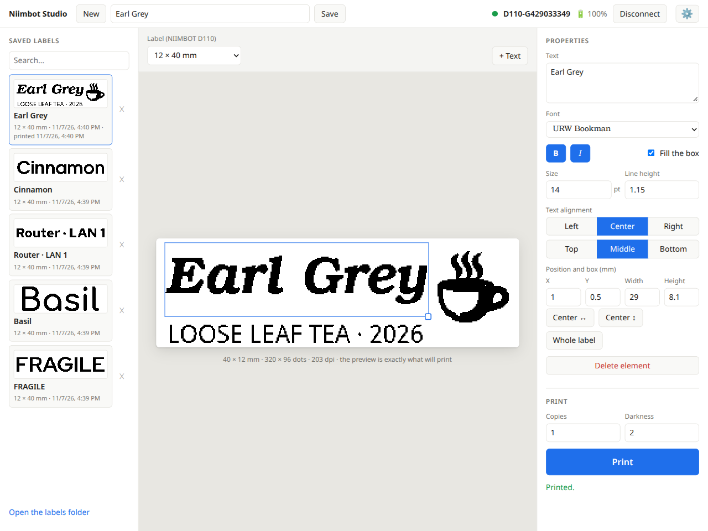
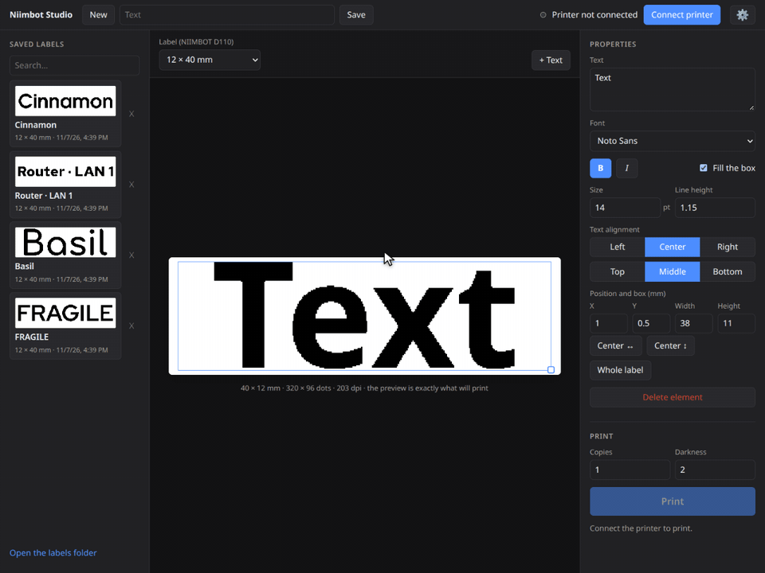

# Niimbot Studio

*Early alpha (0.1): expect rough edges. So far it is tested only on a NIIMBOT D110. Bug reports and ideas are welcome in [Issues](https://github.com/blonestar/niimbot-studio/issues).*

Design and print labels on NIIMBOT thermal printers from your computer, over Bluetooth.
Runs on Windows, macOS and Linux. The interface is in English and Serbian (Latin and Cyrillic).

<picture>
  <source media="(prefers-color-scheme: dark)" srcset="docs/screenshot-dark.png">
  
</picture>

## See it work

Pick the printer, connect, design a label with three pieces of text, save it, and print it:



## Features

- **What you see is what prints.** The preview is the exact black-and-white image the print head burns.
- **Text that fits.** Any installed font, bold and italic, alignment, fixed size or "fill the box".
- **Drag to place.** Move and resize text on the label with the mouse or the arrow keys.
- **Label library.** Saved labels with thumbnails and the date you last printed them.
- **No pairing.** Connect from the app; the printer does not need to be paired with the system.
- **Updates itself** from GitHub Releases.

## Supported printers

| Model | Print head | Resolution | Label rolls |
| --- | --- | --- | --- |
| NIIMBOT D110 | 12 mm | 203 dpi | 12 × 22 to 12 × 109 mm |
| NIIMBOT D110 M | 12 mm | 203 dpi | 12 × 22 to 12 × 109 mm |
| NIIMBOT D11, D11S | 12 mm | 203 dpi | 12 × 22 to 12 × 109 mm |
| NIIMBOT B1, B21 | 48 mm | 203 dpi | 30 × 15 to 50 × 50 mm |

Tested on a D110. The others use the same protocol through
[niimbluelib](https://github.com/MultiMote/niimbluelib); reports from owners are welcome.

## Download

Get the installer for your system from [Releases](https://github.com/blonestar/niimbot-studio/releases).

On macOS the app is not signed by Apple yet. The first time, macOS refuses to open it: open
**System Settings → Privacy & Security** and click **Open Anyway**. New versions are not installed
automatically on macOS; Settings shows a download link instead.

## Develop

```sh
npm install
npm run dev
```

If Electron fails to start with "Electron uninstall", run `node node_modules/electron/install.js`.

| Path | Contents |
| --- | --- |
| `src/shared/` | Types shared by the main process and the UI: the label document, settings, IPC API |
| `src/main/` | Electron main process: window, Bluetooth device chooser, label library, settings, updater |
| `src/renderer/src/model/` | The label editor state and the element kinds (`elements/registry.ts`) |
| `src/renderer/src/printers/` | Printer models (`profiles.ts`) and drivers (`niimbot.ts`) |
| `src/renderer/src/i18n/` | Translations. `sr.ts` is the source; Cyrillic is generated from it |
| `scripts/record-demo.mjs` | Records the demo GIF and screenshots above |

### Add a printer model

Add a profile to `src/renderer/src/printers/profiles.ts` with its label rolls. For a printer
brand that NIIMBOT's protocol does not cover, implement `PrinterDriver` from `printers/types.ts`.

### Add a language

Copy `src/renderer/src/i18n/en.ts`, translate it, and register it in `i18n/index.ts`.

## Release

See [RELEASING.md](RELEASING.md).
